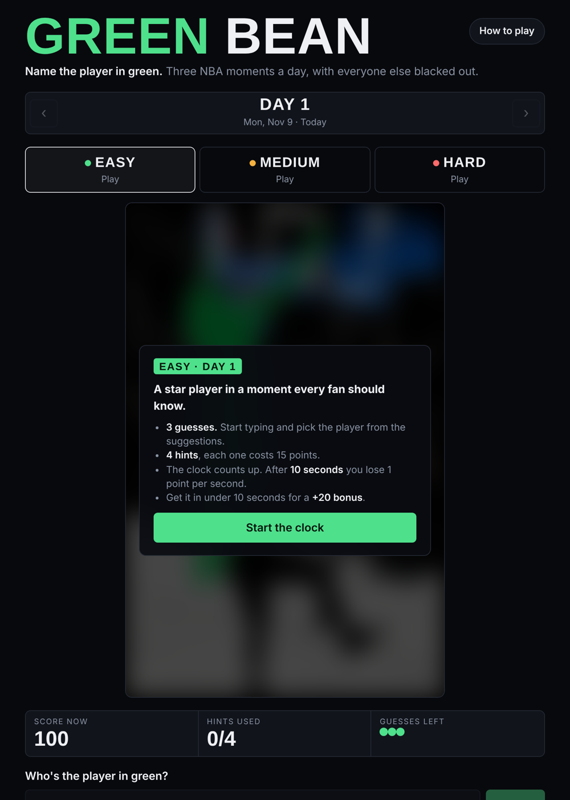

# Who He Play For?

A daily NBA guessing game. Every day there are three moments from NBA history: one Easy, one Medium, and one Hard. Everyone in the scene is blacked out except one player in green. Your job is to name him.

### ▶ [Play it here](https://who-he-play-for.naveenpradeepnair.workers.dev)

## How to play

- Pick a level and play. You can play all three, in any order. Missed a day? Past days stay open.
- Start typing a name or nickname and pick the player from the suggestions. You get **3 guesses**.
- Stuck? There are **4 hints**: the arena, the season, the game, and a teammate. Each one costs 15 points.
- The clock counts up. After 10 seconds you lose 1 point per second, and if you get it in under 10 seconds you get a +20 bonus. Each level is worth up to 120, so a full day is out of 360.
- When you're done, copy your result and send it to your friends (no spoilers).

## Levels

| Level | What that means |
|---|---|
| 🟢 Easy | A star player in a moment every fan knows |
| 🟡 Medium | A famous moment, but the player isn't a superstar |
| 🔴 Hard | A star in a moment most fans forget, or a coach or role player almost nobody remembers |

## Built with

- HTML, CSS, and JavaScript, with no frameworks
- Hosted on Cloudflare Workers
- Name search that handles misspellings and nicknames ("antetokumpo," "Greek Freak," and "MJ" all work)

## Status

Currently in testing with a small group. New moments are added every week.

---

*Fan project. Not affiliated with or endorsed by the NBA or any team.*
